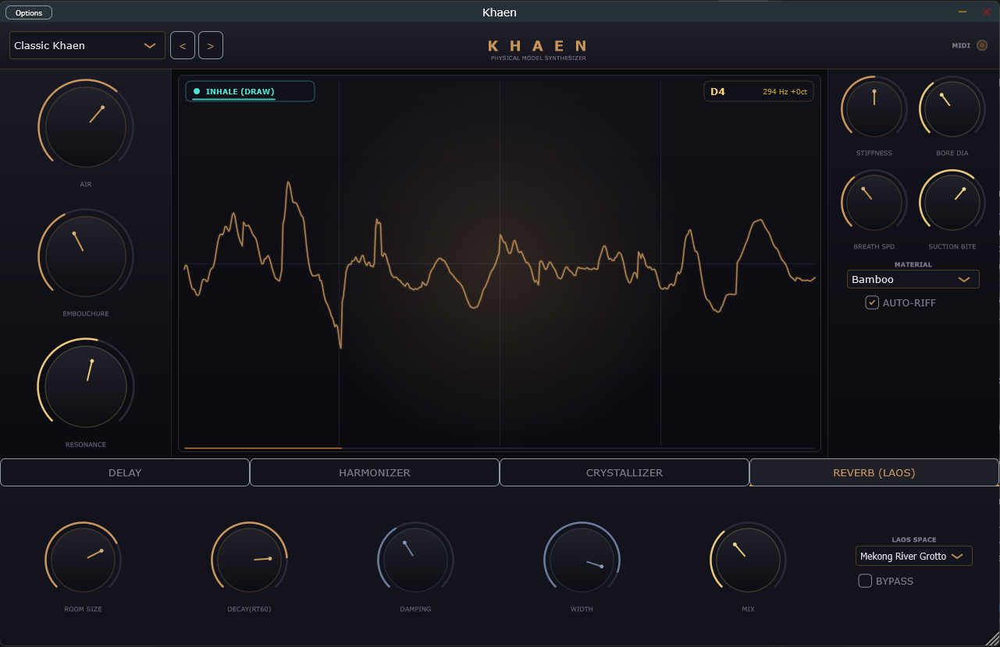
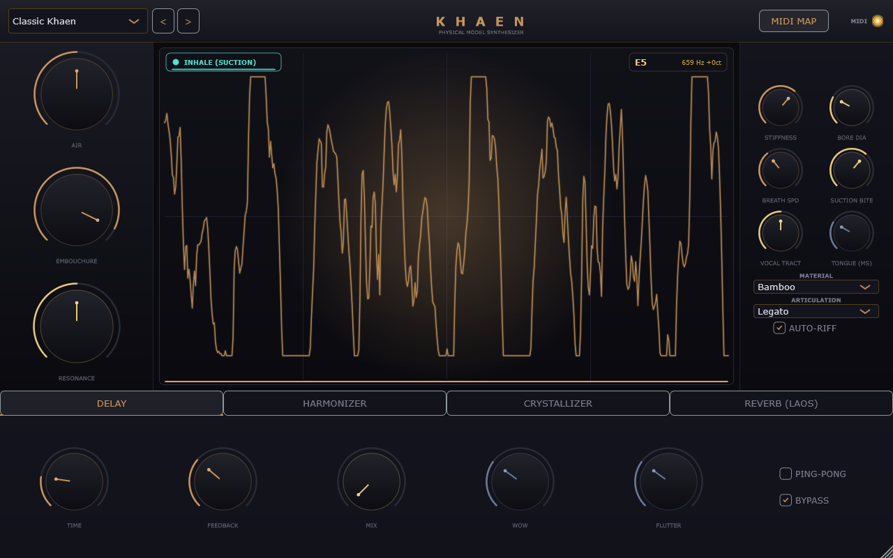
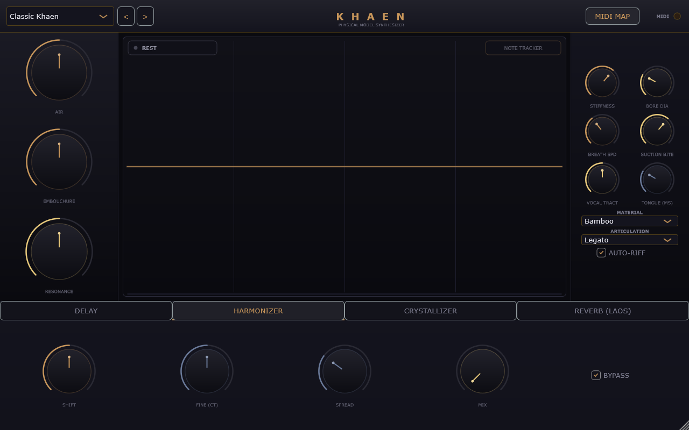
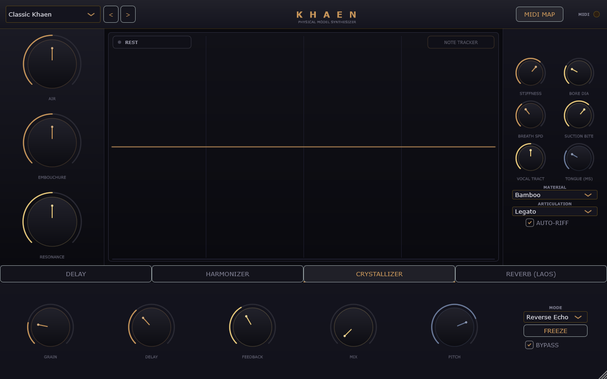
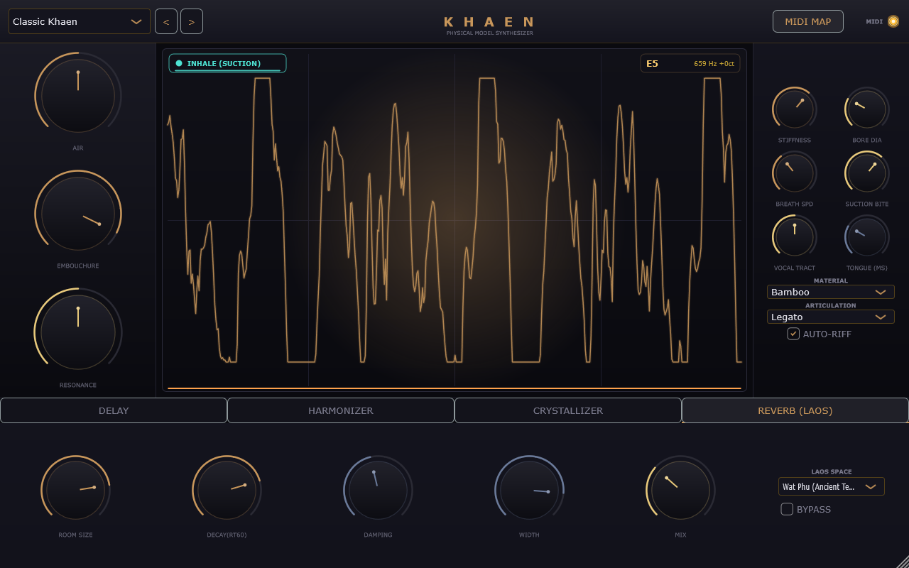

# 🎋 Khaen — Free-Reed Physical Modeling Synthesizer

> **Next-generation digital waveguide physical modeling synthesizer inspired by the traditional Lao & Isan bamboo mouth organ (*Khaen*).**  
> *Engineered in C++17 with JUCE 8 · Full MPE Polyphonic Expression · VST3 / AU / Standalone*

---

<p align="center">
  <a href="https://github.com/manwell47/khaen/raw/main/Khaen_v1.0.0_Windows.zip">
    
  </a>
</p>

<p align="center">
  
  
  
  
  
  
</p>

<p align="center">
  
</p>

---

## ⚡ Direct 1-Click Download & Instant Try

> **No coding or build tools required for music producers and musicians!**

- 📦 **[Download Khaen v1.0.0 for Windows (.zip)](https://github.com/manwell47/khaen/raw/main/Khaen_v1.0.0_Windows.zip)**: Click to download pre-compiled `Khaen.exe` (Standalone) and `Khaen.vst3` (DAW Plugin) ready to run instantly!

---

## Table of Contents
- [Overview](#overview)
- [User Interface & Controls](#user-interface--controls)
- [Plugin Formats & DAW Integration](#plugin-formats--daw-integration)
  - [1. Standalone Application & Audio Interfaces](#1-standalone-application--audio-interfaces)
  - [2. VST3 Plugin](#2-vst3-plugin)
  - [3. Audio Unit (AU) Plugin](#3-audio-unit-au-plugin)
  - [4. Avid Pro Tools Integration](#4-avid-pro-tools-integration)
- [DSP Physical Modeling Architecture](#dsp-physical-modeling-architecture)
- [Building from Source](#building-from-source)
  - [Prerequisites](#prerequisites)
  - [Windows Build](#windows-build)
  - [macOS Build](#macos-build)
- [Built-in Presets](#built-in-presets)
- [Effects Processor Chain](#effects-processor-chain)
- [MPE Expression Mapping](#mpe-expression-mapping)
- [Project Structure](#project-structure)
- [License](#license)

---

## Overview

The **Khaen** (แคน) is a traditional free-reed mouth organ of Lao origin, famed for its rich harmonic spectrum, continuous breath-driven drones, and microtonal vocal-like pitch glissandi.

This plugin physical model simulates the hydrodynamics of free-reed brass tongues coupled to acoustic digital waveguides in real-time, delivering an organic, highly responsive virtual instrument for modern music production, film scoring, and sound design.

<p align="center">
  
</p>

### Key Highlights
- **16-Voice MPE Polyphonic Engine**: Per-note continuous breath pressure modulation, polyphonic pitch glissando, and timbral slide response.
- **Advanced Physical Modeling DSP**: Hirschberg fluid-dynamic reed excitation, dual digital waveguides, and fractional delay lines with Thiran 1st-order allpass interpolation.
- **Dynamic Acoustic Resonators**: Morph between Bamboo, Aged Bamboo, Jade, Brass, Dark Wood, PVC, and Synthetic materials.
- **Studio-Grade FX Suite**: Tape delay with low/high motor flutter, Overlap-Add (OLA) pitch harmonizer, 3-mode granular crystallizer, and algorithmic spatial diffusion reverb.
- **Vector Copper UI**: Real-time oscilloscope waveform display, vector copper rotary controls, and responsive MIDI activity indicators.

---

## User Interface & Controls

Khaen features a dark, vector copper interface centered around a real-time oscilloscope displaying aerodynamic breath flow, note pitch tracking, and dual **Inhale (Suction) / Exhale (Blow)** airflow states.

<p align="center">
  
</p>

---

## Plugin Formats & DAW Integration

Khaen is compiled natively across three major formats: **Standalone**, **VST3**, and **Audio Unit (AU)**.

```
                           ┌───────────────────────────────┐
                           │          KHAEN ENGINE         │
                           └───────────────┬───────────────┘
                                           │
         ┌─────────────────────────────────┼─────────────────────────────────┐
         ▼                                 ▼                                 ▼
┌──────────────────┐             ┌──────────────────┐             ┌──────────────────┐
│    STANDALONE    │             │      VST3        │             │ AUDIO UNIT (AU)  │
│  (.exe / .app)   │             │  (Cross-Platform)│             │  (macOS System)  │
│ ASIO / CoreAudio │             │DAWs / Pro Tools  │             │ Logic / GarageB. │
└──────────────────┘             └──────────────────┘             └──────────────────┘
```

---

### 1. Standalone Application & Audio Interfaces

The **Standalone** binary is a dedicated, low-overhead application designed for live performance, studio tracking, and sound design without launching a DAW.

#### Audio Interface & Driver Compatibility:
- **Low-Latency Drivers**: Fully compatible with ASIO 2.0 (Windows), CoreAudio (macOS), and ALSA/JACK (Linux).
- **Professional Hardware**: Optimized for multi-channel audio interfaces (Universal Audio Apollo, RME Fireface/HDSPe, Focusrite Scarlett/Clarett, MOTU, Audient, Antelope Audio, SSL, Behringer X32/Wing, etc.).
- **High Sample-Rate Processing**: Supports 44.1 kHz, 48 kHz, 88.2 kHz, 96 kHz, and 192 kHz sample rates with ultra-low buffer configurations (32 to 256 samples).

#### Launching:
- **Windows**: Run `build\Khaen_artefacts\Release\Standalone\Khaen.exe` or double-click [Khaen_Standalone.bat](./Khaen_Standalone.bat).
- **macOS**: Open `build/Khaen_artefacts/Release/Standalone/Khaen.app`.

---

### 2. VST3 Plugin

**VST3** (Virtual Studio Technology 3) is the cross-platform industry standard plugin format developed by Steinberg, supported by major digital audio workstations worldwide.

#### Supported DAWs:
Ableton Live, FL Studio, REAPER, Steinberg Cubase / Nuendo, Bitwig Studio, PreSonus Studio One, BandLab Cakewalk, Reason, Renoise, Tracktion Waveform, and Avid Pro Tools (via VST3 host).

#### Standard Installation Directories:
- **Windows (64-bit)**: `C:\Program Files\Common Files\VST3\Khaen.vst3`
- **macOS**: `/Library/Audio/Plug-Ins/VST3/Khaen.vst3` or `~/Library/Audio/Plug-Ins/VST3/Khaen.vst3`

---

### 3. Audio Unit (AU) Plugin

**Audio Unit (AU / `.component`)** is the native system audio plugin format integrated directly into macOS CoreAudio.

#### Supported Hosts:
- **Apple Logic Pro** (Logic Pro X / 11)
- **GarageBand**
- **MainStage**
- **Ableton Live** (macOS AU host mode)
- **REAPER** (macOS)
- **PreSonus Studio One** (macOS)

#### Standard Installation Directory:
- **macOS**: `/Library/Audio/Plug-Ins/Components/Khaen.component`

---

### 4. Avid Pro Tools Integration

For **Avid Pro Tools** (Pro Tools Ultimate, Pro Tools Studio, Pro Tools Artist):

- **Native VST3 Support**: Pro Tools 2023.6+ natively supports VST3 plugins directly on AAX track slots.
- **AAX Hosting / Wrappers**: For legacy Pro Tools systems, Khaen loads seamlessly via standard plugin wrappers (Blue Cat's PatchWork, Metaplugin, or DDMF).

---

## DSP Physical Modeling Architecture

```
                          [ MIDI In / 5D MPE Controller ]
                                         │
                                         ▼
                     ┌───────────────────────────────────────┐
                     │     Polyphonic MPE Voice Manager      │
                     │   - Voice Allocation (16 voices)      │
                     │   - Per-note Pressure, Slide, Bend    │
                     └───────────────────┬───────────────────┘
                                         │
       ┌─────────────────────────────────┴─────────────────────────────────┐
       ▼                                                                   ▼
┌──────────────┐                  (Voices 2 to 15)                  ┌──────────────┐
│ KhaenVoice 1 │ ◄────────────────────────────────────────────────► │ KhaenVoice 16│
└──────┬───────┘                                                    └──────┬───────┘
       │                                                                   │
       └─────────────────────────────────┬─────────────────────────────────┘
                                         ▼
                 ┌──────────────────────────────────────────────┐
                 │       PHYSICAL MODELING FREE-REED DSP        │
                 │ ┌──────────────────────────────────────────┐ │
                 │ │ 1. Hirschberg Fluid Excitation           │ │
                 │ │    Pressure differential dP & Flow Q(t)  │ │
                 │ ├──────────────────────────────────────────┤ │
                 │ │ 2. Non-Linear Tongue Dynamics ODE        │ │
                 │ │    d^2y/dt^2 + 2g*dy/dt + w0^2*y = F(t)  │ │
                 │ ├──────────────────────────────────────────┤ │
                 │ │ 3. Thiran 1st-Order Allpass Interpolator │ │
                 │ │    D(z) Fractional Delay Tuning          │ │
                 │ ├──────────────────────────────────────────┤ │
                 │ │ 4. Dual Digital Waveguide Pipe           │ │
                 │ │    P+(n) Forward & P-(n) Backward Waves  │ │
                 │ ├──────────────────────────────────────────┤ │
                 │ │ 5. Radiation Loss & Material Damping     │ │
                 │ │    H_rad(z) Pipe Termination Filter      │ │
                 │ └──────────────────────────────────────────┘ │
                 └───────────────────────┬──────────────────────┘
                                         │  (Stereo Voice Bus Sum)
                                         ▼
                 ┌──────────────────────────────────────────────┐
                 │            POST-PROCESSING FX SUITE          │
                 │ ┌──────────────────────────────────────────┐ │
                 │ │ 1. Analog Tape Delay                     │ │
                 │ │    Wow/Flutter, Saturation, Ping-Pong    │ │
                 │ ├──────────────────────────────────────────┤ │
                 │ │ 2. Overlap-Add (OLA) Pitch Harmonizer    │ │
                 │ │    Microtonal Shifter (+/-12 Semitones)  │ │
                 │ ├──────────────────────────────────────────┤ │
                 │ │ 3. 3-Mode Granular Crystallizer          │ │
                 │ │    Mode 0: Reverse | 1: Pitch | 2: Freeze│ │
                 │ ├──────────────────────────────────────────┤ │
                 │ │ 4. Algorithmic Stereo Diffusion Reverb   │ │
                 │ └──────────────────────────────────────────┘ │
                 └───────────────────────┬──────────────────────┘
                                         │
                                         ▼
                 ┌──────────────────────────────────────────────┐
                 │            MASTER OUTPUT & MONITOR           │
                 │  * Soft-Clipping Safety Limiter              │
                 │  * Vector Oscilloscope Waveform Visualizer   │
                 └───────────────────────┬──────────────────────┘
                                         │
                                         ▼
                              [ Stereo Audio Output ]
```

---

## Building from Source

### Prerequisites

| Tool | Minimum Version | Check Command | Purpose |
|------|-----------------|---------------|---------|
| **CMake** | 3.22+ | `cmake --version` | Cross-platform build generator |
| **Git** | Any recent | `git --version` | JUCE 8 source dependency manager |
| **Visual Studio** (Windows) | 2022 (C++ Desktop) | `vswhere` | MSVC compiler & Windows SDK |
| **Xcode / Command Line Tools** (macOS) | 14.0+ | `clang --version` | Apple Clang compiler |
| **Python** (Optional) | 3.8+ | `python --version` | LiteLLM routing proxy & prototype |

---

### Windows Build

Run the automated PowerShell build script:

```powershell
# Standard Release build:
.\build.ps1

# Clean rebuild:
.\build.ps1 -Clean

# Debug build:
.\build.ps1 -Debug
```

*Or configure manually with CMake:*

```powershell
cmake -B build -G "Visual Studio 17 2022" -A x64 -DCMAKE_BUILD_TYPE=Release
cmake --build build --config Release --parallel
```

Build outputs:
- **VST3**: `build\Khaen_artefacts\Release\VST3\Khaen.vst3`
- **Standalone**: `build\Khaen_artefacts\Release\Standalone\Khaen.exe`
- **Tests**: `build\Tests\Release\KhaenDspTest.exe`

---

### macOS Build

```bash
# Configure for Xcode / Clang with Universal Binary support (Apple Silicon + Intel):
cmake -B build -G "Unix Makefiles" \
      -DCMAKE_BUILD_TYPE=Release \
      -DCMAKE_OSX_ARCHITECTURES="arm64;x86_64"

# Build all targets (VST3, AU, Standalone):
cmake --build build --config Release -j$(sysctl -n hw.ncpu)
```

Build outputs in `build/Khaen_artefacts/Release/`:
- `VST3/Khaen.vst3`
- `AU/Khaen.component`
- `Standalone/Khaen.app`

---

## Built-in Presets

Khaen includes 10 factory presets tailored to explore the full timbral spectrum from acoustic physical accuracy to dark ambient drones:

<p align="center">
  
</p>

| # | Preset Name | Resonator Material | Sonic Profile & Character |
|---|-------------|--------------------|---------------------------|
| **1** | **Classic Khaen** | Bamboo | Traditional Lao mouth organ, warm acoustic reed timbre. |
| **2** | **Breath of Laos** | Aged Bamboo | Airy, spacious with subtle organic breath turbulence. |
| **3** | **Jade Reed** | Jade | Bright, crystalline harmonics, crisp transient attack. |
| **4** | **Copper Tongue** | Brass | Metallic, punchy reed bite with fast resonance response. |
| **5** | **Ghost Pipe** | PVC | Dark, hollow, haunting flute-like undertones. |
| **6** | **Deep Resonance** | Dark Wood | Sub-bass drone, warm woody fundamental sustain. |
| **7** | **Crystal Air** | Bamboo | Shimmering pitch-shifted granular clouds. |
| **8** | **Storm Reed** | Metal | Aggressive, overblown reed with dynamic noise burst. |
| **9** | **Silk Breath** | Polished Bamboo | Smooth, lyrical legato with gentle breath response. |
| **10** | **Void Drone** | Synthetic | Deep alien drone, infinite granular sustain and freeze. |

---

## Effects Processor Chain

Khaen embeds four studio-grade DSP effect modules integrated into the lower control rack:

### 1. Analog Tape Delay
Simulates vintage magnetic tape motor fluctuations, soft-clipping tape drive, and ping-pong crossfeed routing.

<p align="center">
  
</p>

- **Parameters**: Time (1–2000 ms), Feedback, Mix, Wow (LF motor instability), Flutter (HF capstan flutter), Ping-Pong toggle.

---

### 2. Pitch Harmonizer
An Overlap-Add (OLA) real-time pitch shifter providing microtonal offset and interval transposition ($\pm 12$ semitones).

<p align="center">
  
</p>

- **Parameters**: Shift ($\pm 12$ semitones), Fine tuning (cents), Stereo Spread, Mix.

---

### 3. Granular Crystallizer
A multi-mode granular engine for pitch-shifted grain clouds, reverse echoes, and frozen micro-loops.

<p align="center">
  
</p>

- **Modes**:
  - **Mode 0 (Reverse Echo)**: Backward grain playback.
  - **Mode 1 (Pitch Shimmer)**: Pitch-shifted feedback loop.
  - **Mode 2 (Glitch Freeze)**: Infinite granular buffer freeze.
- **Parameters**: Grain size, Delay, Feedback, Mix, Pitch, Freeze button.

---

### 4. Algorithmic Reverb (Laos Space)
A high-density stereo diffusion reverb featuring custom acoustic impulse responses representing iconic Lao acoustic environments.

<p align="center">
  
</p>

- **Laos Space Presets**:
  - *Wat Phu (Ancient Temple)*
  - *Luang Prabang Sanctuary*
  - *Tham Kong Lor (Giant Cave)*
  - *That Luang Pavilion*
  - *Mekong River Grotto*
- **Parameters**: Room Size, Decay (RT60), Damping, Width, Mix.

---

## MPE Expression Mapping

Khaen is designed from the ground up for **MIDI Polyphonic Expression (MPE)**:

| MPE Dimension | MIDI Control | Synthesis Parameter Modulation |
|---------------|--------------|--------------------------------|
| **Pressure (Z)** | Channel Pressure / Poly Aftertouch | Breath intensity, reed displacement, and aerodynamic non-linear airflow. |
| **Slide (Y)** | MIDI CC #74 (Timbre) | Lip damping, embouchure pressure, and high-frequency waveguide cutoff. |
| **Pitch Bend (X)** | Note Pitch Bend ($\pm 48$ semitones) | Continuous microtonal waveguide length modulation for seamless glissandi. |
| **Strike (Velocity)** | Note-On Velocity | Initial reed tongue impulse and tongue attack transient speed. |
| **Lift (Release)** | Note-Off Velocity | Airflow decay rate and pipe residual resonance dissipation. |

---

## Project Structure

```
Khaen/
├── CMakeLists.txt              # JUCE 8 build configuration (FetchContent)
├── build.ps1                   # Automated build script for Windows
├── build.bat                   # Quick double-click build launcher
├── Khaen_Standalone.bat        # Direct standalone app launcher
├── start_proxy.ps1             # Optional LiteLLM proxy manager
├── litellm_config.example.yaml # Model routing configuration template
├── Khaen_v1.0.0_Windows.zip    # Pre-compiled executable & VST3 package
├── README.md                   # Project documentation
│
├── Source/
│   ├── PluginProcessor.h/cpp   # Audio processor & APVTS parameter tree
│   ├── PluginEditor.h/cpp      # Main GUI editor & custom look-and-feel
│   │
│   ├── DSP/
│   │   ├── FreeReedModel.h/cpp      # Hirschberg reed & digital waveguide physics
│   │   ├── KhaenVoice.h/cpp         # Polyphonic MPE voice handler
│   │   └── KhaenSynthesiser.h/cpp   # Synthesiser engine & voice management
│   │
│   ├── FX/
│   │   ├── TapeDelay.h/cpp          # Tape delay with wow/flutter & saturation
│   │   ├── Harmonizer.h/cpp         # OLA pitch shifter
│   │   ├── GranularCrystallizer.h/cpp # Multi-mode granular processor
│   │   └── ReverbEngine.h/cpp       # Algorithmic stereo reverb
│   │
│   ├── Presets/
│   │   └── PresetManager.h/cpp      # 10 Factory presets & snapshot manager
│   │
│   └── UI/
│       ├── CustomKnob.h/cpp         # Vector copper rotary knobs
│       ├── WaveVisualizer.h/cpp     # Real-time audio oscilloscope
│       └── MidiLed.h                # Responsive MIDI activity indicator
│
└── Tests/
    └── DspTest.cpp             # Unit tests for physical model stability
```

---

## License

This project is licensed under the **MIT License** — see the [LICENSE](LICENSE) file for details.

*Crafted with passion for physical modeling synthesis and traditional world instruments.* 🎋
