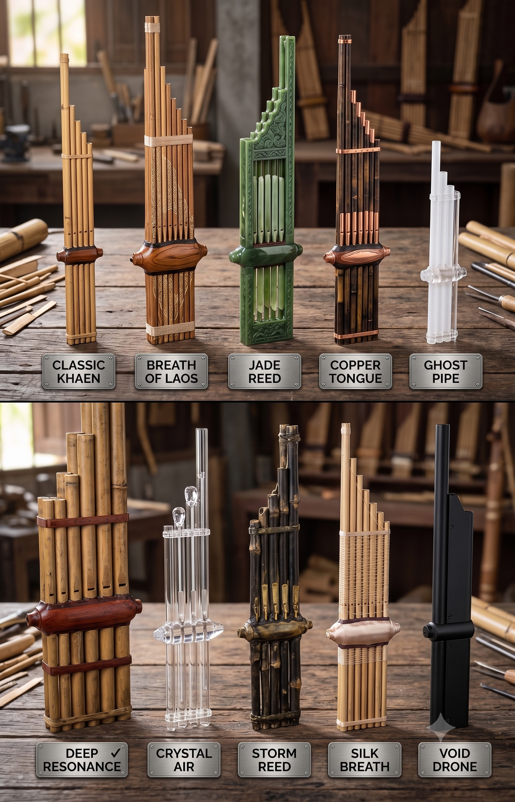

<p align="center">
  
</p>

# 🎋 Khaen — Free-Reed Physical Modeling Synthesizer

> **Next-generation digital waveguide synthesizer inspired by the traditional Lao & Isan bamboo mouth organ (*Khaen*).**  
> *Engineered in C++17 with JUCE 8 · Full MPE Polyphonic Expression · VST3 / AU / Standalone*

---

<p align="center">
  
  
  
  
  
  
  
</p>

---

## Table of Contents
- [Overview](#overview)
- [Plugin Formats & How to Use](#plugin-formats--how-to-use)
  - [1. Standalone Application](#1-standalone-application)
  - [2. VST3 Plugin](#2-vst3-plugin)
  - [3. AU (Audio Unit) Plugin for macOS / Apple](#3-au-audio-unit-plugin-for-macos--apple)
- [Building from Source](#building-from-source)
  - [Prerequisites](#prerequisites)
  - [Windows Build](#windows-build)
  - [macOS Build](#macos-build)
- [DSP Physical Model Architecture](#dsp-physical-model-architecture)
- [Built-in Presets](#built-in-presets)
- [Effects Chain](#effects-chain)
- [MPE Expression Mapping](#mpe-expression-mapping)
- [Project Structure](#project-structure)
- [License](#license)

---

## Overview

The **Khaen** (แคน) is a traditional free-reed mouth organ of Lao origin, known for its rich harmonic spectrum, singing continuous breath textures, and microtonal vocal-like glissandi.

This plugin accurately simulates the complex physics of free reeds coupled to resonant acoustic pipe waveguides in real-time, delivering an expressive, organic virtual instrument ready for modern music production and sound design.

### Key Highlights
- **16-Voice MPE Engine**: Per-note continuous breath pressure, polyphonic pitch glissando, and timbral slide control.
- **Physical Modeling Synthesis**: Hirschberg hydrodynamic non-linear reed excitation, dual digital waveguides, and fractional delay lines with Thiran allpass interpolation.
- **Dynamic Materials**: Morph between Bamboo, Aged Bamboo, Jade, Brass, Dark Wood, PVC, and Synthetic resonators.
- **Integrated FX Processor**: Analog tape delay with wow/flutter, overlap-add pitch harmonizer, 3-mode granular crystallizer, and algorithmic reverb.
- **Vector Copper UI**: Real-time oscilloscope waveform visualizer, copper rotary knobs, and responsive MIDI activity monitors.

---

## Plugin Formats & How to Use

Khaen is built simultaneously into three formats: **Standalone**, **VST3**, and **AU (Audio Unit)**.

```
                  ┌───────────────────────────────┐
                  │          KHAEN ENGINE         │
                  └───────────────┬───────────────┘
                                  │
         ┌────────────────────────┼────────────────────────┐
         ▼                        ▼                        ▼
┌──────────────────┐    ┌──────────────────┐    ┌──────────────────┐
│    STANDALONE    │    │      VST3        │    │    AU (APPLE)    │
│  (.exe / .app)   │    │  (Cross-Platform)│    │     (macOS)      │
│ Play without DAW │    │ Cubase/Ableton/FL│    │Logic/GarageBand  │
└──────────────────┘    └──────────────────┘    └──────────────────┘
```

---

### 1. Standalone Application

The **Standalone** version is a self-contained executable that runs directly on your computer without requiring any Digital Audio Workstation (DAW).

#### Best For:
- Live performance, practice, and sound design sessions.
- Immediate plug-and-play with your USB / MIDI / MPE keyboard.

#### How to Launch:
- **Windows**: Run `build\Khaen_artefacts\Release\Standalone\Khaen.exe` or simply double-click [Khaen_Standalone.bat](./Khaen_Standalone.bat).
- **macOS**: Open `build/Khaen_artefacts/Release/Standalone/Khaen.app`.

#### Configuration:
1. Click **Options / Settings** (or the Audio/MIDI gear icon).
2. Select your **Audio Device** (ASIO / WASAPI on Windows, CoreAudio on macOS).
3. Set your preferred sample rate (44.1 kHz, 48 kHz, or 96 kHz) and buffer size (64 to 256 samples for lowest latency).
4. Enable your MIDI controller under **Active MIDI Inputs**.

---

### 2. VST3 Plugin

**VST3** (Virtual Studio Technology 3) is the cross-platform industry standard plugin format developed by Steinberg, supported by virtually all modern DAWs on Windows, macOS, and Linux.

#### Supported DAWs:
Ableton Live, FL Studio, REAPER, Steinberg Cubase / Nuendo, Bitwig Studio, PreSonus Studio One, Cakewalk by BandLab, Reason, Renoise, Tracktion Waveform, and more.

#### Installation Paths:
- **Windows (64-bit)**:
  ```powershell
  # Copy Khaen.vst3 into the standard Windows VST3 directory:
  Copy-Item -Recurse "build\Khaen_artefacts\Release\VST3\Khaen.vst3" `
            "C:\Program Files\Common Files\VST3\"
  ```
- **macOS**:
  ```bash
  # System-wide installation:
  sudo cp -R "build/Khaen_artefacts/Release/VST3/Khaen.vst3" "/Library/Audio/Plug-Ins/VST3/"
  # Or User-only installation:
  cp -R "build/Khaen_artefacts/Release/VST3/Khaen.vst3" "~/Library/Audio/Plug-Ins/VST3/"
  ```

#### How to Use in your DAW:
1. Open your DAW and rescan plugins if needed.
2. Insert **Khaen** as a virtual instrument on a MIDI / Instrument track.
3. If using an MPE controller (Roli Seaboard, LinnStrument, Keith McMillen K-Board, Ableton Push 3, Sensel Morph), enable **MPE Mode** in your DAW track inspector.

---

### 3. AU (Audio Unit) Plugin for macOS / Apple

**Audio Unit (AU / `.component`)** is Apple's native, system-level audio plugin architecture for macOS. It delivers deep integration with macOS CoreAudio and Apple Silicon (M1/M2/M3/M4) hardware.

#### Supported Apple DAWs & Hosts:
- **Apple Logic Pro** (Logic Pro X / 11)
- **GarageBand**
- **Apple MainStage**
- **Ableton Live** (macOS AudioUnit version)
- **REAPER** (macOS)
- **Studio One** (macOS AU host)

#### Installation Path:
```bash
# Copy the compiled AU component to macOS Components folder:
sudo cp -R "build/Khaen_artefacts/Release/AU/Khaen.component" "/Library/Audio/Plug-Ins/Components/"
```

#### How to Use in Logic Pro / GarageBand:
1. In Logic Pro, create a new **Software Instrument** track.
2. Under the Instrument slot, navigate to:  
   `AU Instruments` $\rightarrow$ `KhaenAudio` $\rightarrow$ `Khaen` $\rightarrow$ `Stereo`.
3. To verify Apple AU validation:
   ```bash
   auval -v aumu Khen KhAu
   ```

---

## Building from Source

### Prerequisites

| Tool | Minimum Version | Check Command | Purpose |
|------|-----------------|---------------|---------|
| **CMake** | 3.22+ | `cmake --version` | Build system generator |
| **Git** | Any recent | `git --version` | JUCE 8 FetchContent dependency |
| **Visual Studio** (Windows) | 2022 (C++ Desktop) | `vswhere` | MSVC compiler & toolchain |
| **Xcode / Command Line Tools** (macOS) | 14.0+ | `clang --version` | Apple Clang compiler |
| **Python** (Optional) | 3.8+ | `python --version` | LiteLLM routing proxy & prototype |

---

### Windows Build

Run the automated PowerShell build script:

```powershell
# Standard Release build:
.\build.ps1

# Clean rebuild:
.\build.ps1 -Clean

# Debug build:
.\build.ps1 -Debug
```

*Or build manually with CMake:*

```powershell
cmake -B build -G "Visual Studio 17 2022" -A x64 -DCMAKE_BUILD_TYPE=Release
cmake --build build --config Release --parallel
```

The compiled binaries will be placed in:
- VST3: `build\Khaen_artefacts\Release\VST3\Khaen.vst3`
- Standalone: `build\Khaen_artefacts\Release\Standalone\Khaen.exe`
- Tests: `build\Tests\Release\KhaenDspTest.exe`

---

### macOS Build

```bash
# Configure for Xcode / Clang with Universal Binary support:
cmake -B build -G "Unix Makefiles" \
      -DCMAKE_BUILD_TYPE=Release \
      -DCMAKE_OSX_ARCHITECTURES="arm64;x86_64"

# Build all targets (VST3, AU, Standalone):
cmake --build build --config Release -j$(sysctl -n hw.ncpu)
```

The compiled artifacts will be located in `build/Khaen_artefacts/Release/`:
- `VST3/Khaen.vst3`
- `AU/Khaen.component`
- `Standalone/Khaen.app`

---

## DSP Physical Model Architecture

```
                                  [ MIDI In / MPE ]
                                          │
                                          ▼
                               ┌─────────────────────┐
                               │   KhaenSynthesiser  │ (16 Polyphonic Voices)
                               └──────────┬──────────┘
                                          │
               ┌──────────────────────────┴──────────────────────────┐
               ▼                                                     ▼
      ┌─────────────────┐                                   ┌─────────────────┐
      │  KhaenVoice 1   │  ... (Voice 2 - 15) ...           │  KhaenVoice 16  │
      └────────┬────────┘                                   └────────┬────────┘
               │                                                     │
               └──────────────────────────┬──────────────────────────┘
                                          ▼
                               ┌─────────────────────┐
                               │   FreeReedModel     │
                               │  ├── Hirschberg Ex. │
                               │  ├── Dual Waveguide │
                               │  ├── Thiran Allpass │
                               │  └── Radiation Loss │
                               └──────────┬──────────┘
                                          ▼
                               ┌─────────────────────┐
                               │      TapeDelay      │ (Wow/Flutter, Ping-Pong)
                               └──────────┬──────────┘
                                          ▼
                               ┌─────────────────────┐
                               │      Harmonizer     │ (OLA Pitch Shift ±12 semi)
                               └──────────┬──────────┘
                                          ▼
                               ┌─────────────────────┐
                               │ GranularCrystallizer│ (Reverse, Pitch FB, Freeze)
                               └──────────┬──────────┘
                                          ▼
                               ┌─────────────────────┐
                               │    ReverbEngine     │ (Spatial Diffusion)
                               └──────────┬──────────┘
                                          ▼
                               ┌─────────────────────┐
                               │  Stereo Audio Out   │
                               └─────────────────────┘
```

---

## Built-in Presets

Khaen includes 10 factory presets tailored to explore the full timbral range from authentic ethnic acoustic modeling to futuristic ambient pads:

| # | Preset Name | Resonator Material | Character & Sonic Profile |
|---|-------------|--------------------|---------------------------|
| **1** | **Classic Khaen** | Bamboo | Traditional Lao mouth organ, warm acoustic reed timbre. |
| **2** | **Breath of Laos** | Aged Bamboo | Airy, spacious with subtle organic breath turbulence. |
| **3** | **Jade Reed** | Jade | Bright, crystalline harmonics, crisp transient attack. |
| **4** | **Copper Tongue** | Brass | Metallic, punchy reed bite with fast resonance response. |
| **5** | **Ghost Pipe** | PVC | Dark, hollow, haunting flute-like undertones. |
| **6** | **Deep Resonance** | Dark Wood | Sub-bass drone, warm woody fundamental sustain. |
| **7** | **Crystal Air** | Bamboo | Shimmering pitch-shifted granular clouds. |
| **8** | **Storm Reed** | Metal | Aggressive, overblown reed with dynamic noise burst. |
| **9** | **Silk Breath** | Polished Bamboo | Smooth, lyrical legato with gentle breath response. |
| **10** | **Void Drone** | Synthetic | Deep alien drone, infinite granular sustain and freeze. |

---

## Effects Chain

1. **Analog Tape Delay**:
   - Delay time (1 ms to 2000 ms), feedback, stereo ping-pong crossfeed.
   - Low-frequency wow and high-frequency flutter tape motor simulation with soft-clipping tape drive.
2. **Pitch Harmonizer**:
   - Overlap-Add (OLA) micro-pitch and interval shifter ($\pm 12$ semitones).
   - Preserves formant resonance while creating lush octaves and fifths.
3. **Granular Crystallizer**:
   - **Mode 0 (Reverse Echo)**: Backward grain playback for psychedelic textures.
   - **Mode 1 (Pitch Shimmer)**: Octave-shifted feedback loop with grain diffusion.
   - **Mode 2 (Glitch Freeze)**: Infinite micro-loop freeze with randomized grain windows.
4. **Algorithmic Reverb**:
   - Smooth stereo diffusion with adjustable room size, damping, and decay.

---

## MPE Expression Mapping

Khaen is designed from the ground up for **MIDI Polyphonic Expression (MPE)**:

| MPE Dimension | MIDI Control | Synthesis Parameter Modulation |
|---------------|--------------|--------------------------------|
| **Pressure (Z)** | Channel Pressure / Poly Aftertouch | Breath intensity, reed displacement, and aerodynamic non-linear airflow. |
| **Slide (Y)** | MIDI CC #74 (Timbre) | Lip damping, embouchure pressure, and high-frequency waveguide cutoff. |
| **Pitch Bend (X)** | Note Pitch Bend ($\pm 48$ semitones) | Continuous microtonal waveguide length modulation for seamless glissandi. |
| **Strike (Velocity)** | Note-On Velocity | Initial reed tongue impulse and tongue attack transient speed. |
| **Lift (Release)** | Note-Off Velocity | Airflow decay rate and pipe residual resonance dissipation. |

---

## Project Structure

```
Khaen/
├── CMakeLists.txt              # JUCE 8 build configuration (FetchContent)
├── build.ps1                   # Automated build script for Windows
├── build.bat                   # Quick double-click build launcher
├── Khaen_Standalone.bat        # Direct standalone app launcher
├── start_proxy.ps1             # Optional LiteLLM proxy manager
├── litellm_config.example.yaml # Model routing configuration template
├── README.md                   # Project documentation
│
├── Source/
│   ├── PluginProcessor.h/cpp   # Audio processor & APVTS parameter tree
│   ├── PluginEditor.h/cpp      # Main GUI editor & custom look-and-feel
│   │
│   ├── DSP/
│   │   ├── FreeReedModel.h/cpp      # Hirschberg reed & digital waveguide physics
│   │   ├── KhaenVoice.h/cpp         # Polyphonic MPE voice handler
│   │   └── KhaenSynthesiser.h/cpp   # Synthesiser engine & voice management
│   │
│   ├── FX/
│   │   ├── TapeDelay.h/cpp          # Tape delay with wow/flutter & saturation
│   │   ├── Harmonizer.h/cpp         # OLA pitch shifter
│   │   ├── GranularCrystallizer.h/cpp # Multi-mode granular processor
│   │   └── ReverbEngine.h/cpp       # Algorithmic stereo reverb
│   │
│   ├── Presets/
│   │   └── PresetManager.h/cpp      # 10 Factory presets & snapshot manager
│   │
│   └── UI/
│       ├── CustomKnob.h/cpp         # Vector copper rotary knobs
│       ├── WaveVisualizer.h/cpp     # Real-time audio oscilloscope
│       └── MidiLed.h                # Responsive MIDI activity indicator
│
└── Tests/
    └── DspTest.cpp             # Unit tests for physical model stability
```

---

## License

This project is licensed under the **MIT License** — see the [LICENSE](LICENSE) file for details.

*Crafted with passion for physical modeling synthesis and traditional world instruments.* 🎋
