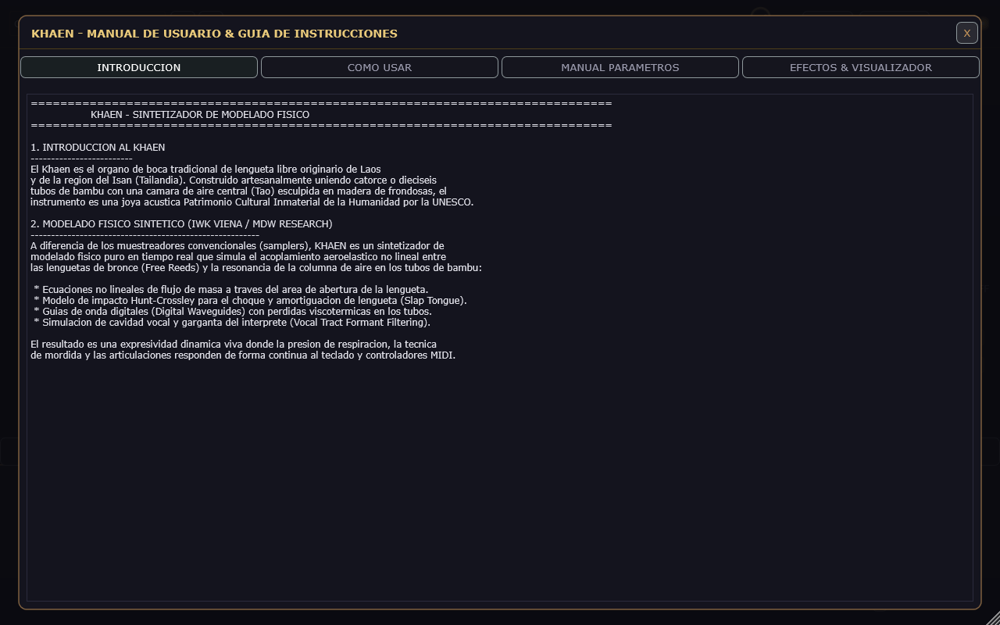
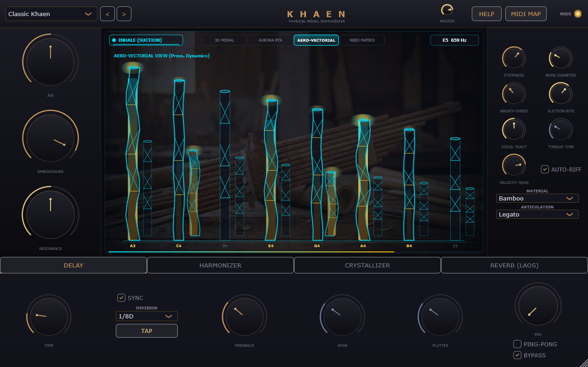
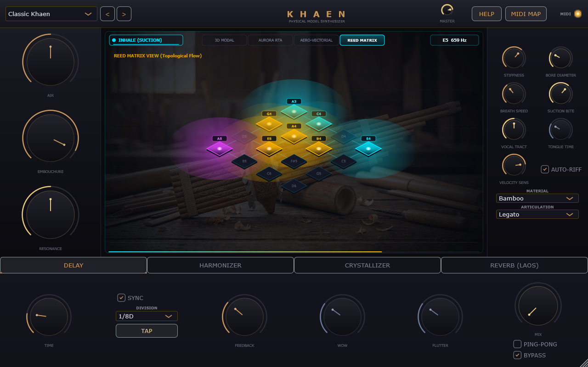
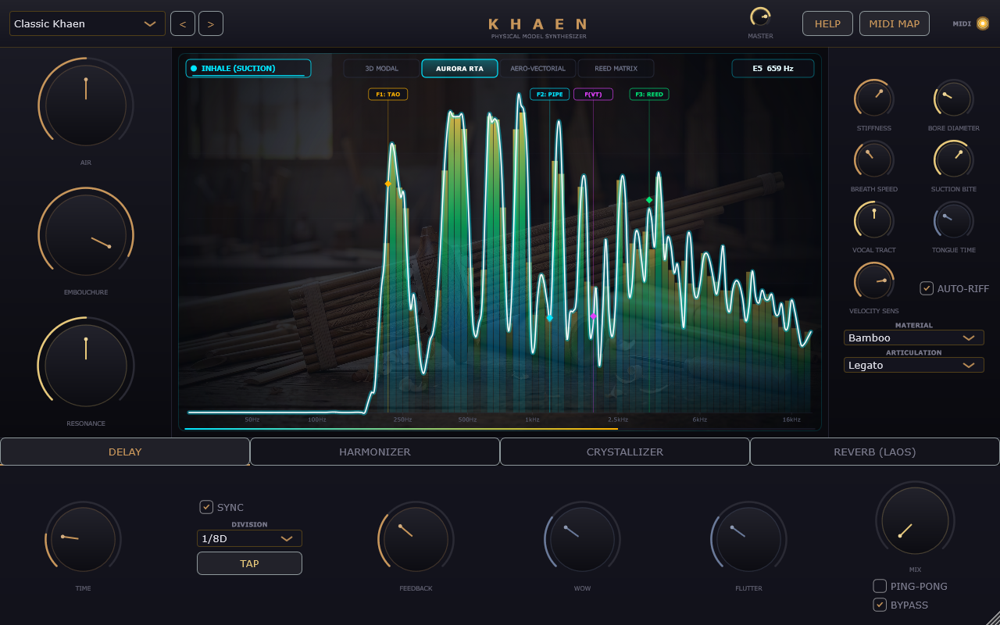
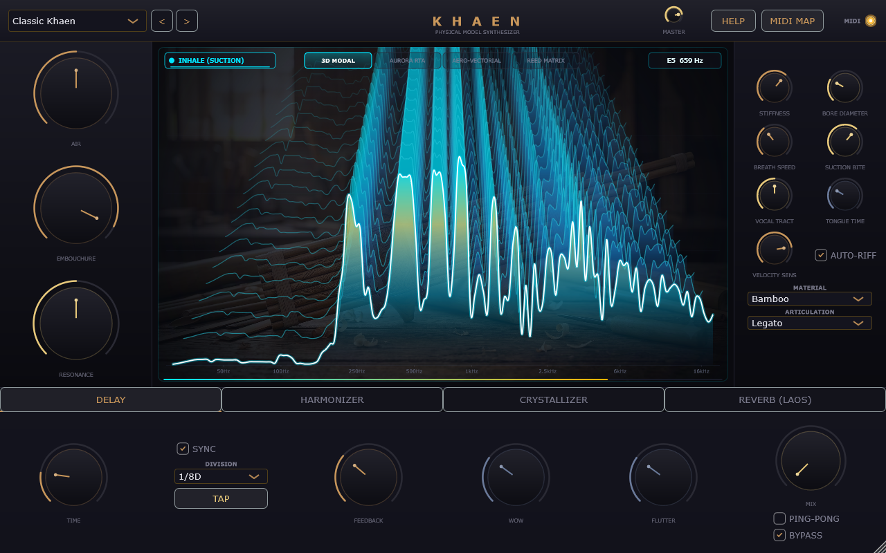

# 🎋 Khaen — Free-Reed Physical Modeling Synthesizer

> **Next-generation digital waveguide physical modeling synthesizer inspired by the traditional Lao & Isan bamboo mouth organ (*Khaen*).**  
> *Engineered in C++17 with JUCE 8 · Full MPE Polyphonic Expression · VST3 / AU / Standalone*

---

<p align="center">
  <a href="https://github.com/manwell47/khaen/raw/main/Khaen_v1.0.0_Windows.zip">
    
  </a>
</p>

<p align="center">
  
  
  
  
  
  
</p>

<p align="center">
  
</p>

---

## ⚡ Direct 1-Click Download & Instant Try

> **No coding or build tools required for music producers and musicians!**

- 📦 **[Download Khaen v1.0.0 for Windows (.zip)](https://github.com/manwell47/khaen/raw/main/Khaen_v1.0.0_Windows.zip)**: Click to download pre-compiled `Khaen.exe` (Standalone) and `Khaen.vst3` (DAW Plugin) ready to run instantly!

---

## Table of Contents
- [Overview](#overview)
- [New Features & HELP User Manual Overlay](#new-features--help-user-manual-overlay)
- [Visualizer Vector Modes](#visualizer-vector-modes)
- [User Interface & Controls](#user-interface--controls)
- [Plugin Formats & DAW Integration](#plugin-formats--daw-integration)
- [DSP Physical Modeling Architecture](#dsp-physical-modeling-architecture)
- [Complete Parameter Reference Manual](#complete-parameter-reference-manual)
- [Building from Source](#building-from-source)
- [Built-in Presets](#built-in-presets)
- [Effects Processor Chain](#effects-processor-chain)
- [MPE Expression Mapping](#mpe-expression-mapping)
- [MIDI CC Mapping & MIDI Learn Matrix](#midi-cc-mapping--midi-learn-matrix)
- [Project Structure](#project-structure)
- [Scientific & Acoustic Foundations](#-scientific--acoustic-foundations)
- [License](#license)

---

## Overview

The **Khaen** (แคน / ଖେନ) is a traditional free-reed mouth organ of Lao origin, famed for its rich harmonic spectrum, continuous breath-driven drones, and microtonal vocal-like pitch glissandi. UNESCO has recognized the Khaen as Intangible Cultural Heritage of Humanity.

This plugin physical model simulates the hydrodynamics of free-reed brass tongues coupled to acoustic digital waveguides in real-time, delivering an organic, highly responsive virtual instrument for modern music production, film scoring, and sound design.

<p align="center">
  
</p>

### Key Highlights
- **16-Voice MPE Polyphonic Engine**: Per-note continuous breath pressure modulation, polyphonic pitch glissando, and timbral slide response.
- **Advanced Physical Modeling DSP**: Hirschberg fluid-dynamic reed excitation, dual digital waveguides, Hunt-Crossley nonlinear collision model, and fractional delay lines with Thiran 1st-order allpass interpolation.
- **Integrated HELP Overlay & Manual**: In-plugin interactive user manual detailing Khaen acoustics, performance keyswitches, and full parameter reference guide.
- **Modern 2D Vector Visualizer Engine**: Four selectable 2D visualizer modes (**Aero-Vectorial**, **Reed Matrix**, **Aurora RTA**, and **3D Modal Waterfall**) with atmospheric *Breath of Laos* background image integration.
- **Dynamic Acoustic Resonators**: Morph between Bamboo, Aged Bamboo, Jade, Brass, Dark Wood, PVC, and Synthetic materials.
- **Studio-Grade FX Suite**: Tape delay with low/high motor flutter, Overlap-Add (OLA) pitch harmonizer, 3-mode granular crystallizer, and 5 Lao sacred location diffusion reverbs.

---

## New Features & HELP User Manual Overlay

Khaen includes an interactive **HELP User Manual & Instruction Guide Overlay** directly inside the GUI toolbar:

<p align="center">
  
</p>

Clicking the **"HELP"** button in the header toolbar opens an overlay with 4 navigable documentation sections:

1. **INTRODUCCION**: Cultural origin of the Khaen, free-reed acoustics, and physical modeling synthesis principles (IWK Vienna / MDW research).
2. **COMO USAR**: Performance guide, polyphony, continuous breath dynamics, performance keyswitches (`C1` Exhale / `D1` Inhale), Auto-Riff, and articulation modes.
3. **MANUAL PARAMETROS**: Complete detailed manual for every knob and control in the Macro, Physics, Vocal Tract, and Master sections.
4. **EFECTOS & VISUALIZADOR**: Technical manual for the Tape Delay, Harmonizer, Crystallizer, Laos Reverb, and 2D Vector Visualizer modes.

---

## Visualizer Vector Modes

The visualizer component features 4 high-performance 2D modes:

<p align="center">
  
  <br><em>1. Aero-Vectorial Mode — 2D Bamboo Pipe Silhouettes with Breath Core Glow & Vertex Wobble Vibration</em>
</p>

<p align="center">
  
  <br><em>2. Reed Matrix Mode — 2D Isometric Windchest Rhombus Grid with Acoustic Pressure Halos & Tone Traces</em>
</p>

<p align="center">
  
  <br><em>3. Aurora RTA Mode — Continuous Real-Time Spectrogram with F1, F2, F3 Formant Tracking</em>
</p>

<p align="center">
  
  <br><em>4. 3D Modal Waterfall Mode — High-Resolution CQT Frequency Spectrum Depth Slices</em>
</p>

---

## Complete Parameter Reference Manual

### 1. Macro Controls (Left Side Panel)
- **AIR (`macroAir`)**: Master airflow pressure, breath velocity, and turbulence noise.
- **EMBOUCHURE (`macroEmbouchure`)**: Lip sealing and aperture ratio over the blowhole channel.
- **RESONANCE (`macroResonance`)**: Acoustic internal reflectivity factor of the bamboo resonator pipes.

### 2. Physical Model & Reed Physics (Right Side Panel)
- **STIFFNESS (`reedStiffness`, 0.00 - 1.00)**: Mechanical stiffness of the brass free-reed cantilever. Higher values produce brighter, sharper harmonics.
- **BORE DIAMETER (`boreDiameter`, 8.0 - 30.0 mm)**: Inner diameter of the bamboo resonator pipe. Modifies fundamental timbre, acoustic Q, and volume.
- **BREATH SPEED (`breathSpeed`, 0.20 - 3.00)**: Response speed of internal air pressure fluctuations to MIDI input dynamics.
- **SUCTION BITE (`suctionBite`, 0.00 - 1.00)**: Transient pop intensity at the start of inhalation (suction cycle).
- **VOCAL TRACT (`vocalTract`, 0.00 - 1.00)**: Oral cavity formant filter modulation ([u] at 280 Hz to [i] at 2600 Hz).
- **TONGUE TIME (`tongueContact`, 10.0 - 100.0 ms)**: Contact damping duration during staccato and slap tongue articulations.
- **VELOCITY SENS (`velocitySens`, 0.00 - 1.00)**: Dynamic sensitivity to incoming MIDI note-on velocity.
- **MATERIAL (`material`)**: Selectable pipe material (Bamboo, Aged Bamboo, Jade, Brass, PVC, Dark Wood, Metal).
- **ARTICULATION (`articulation`)**: Playing style (Legato, Portato, Staccato, Slap Tongue).
- **AUTO-RIFF (`autoInhaleRiff`)**: Automatic traditional Lao Molam trills between held melody notes and drones.

### 3. Master Controls (Header)
- **MASTER VOLUME (`masterVolume`, -24.0 to +6.0 dB)**: Master output level with integrated safety limiter.

---

## Plugin Formats & DAW Integration

Khaen is compiled natively across three major formats: **Standalone**, **VST3**, and **Audio Unit (AU)**.

```
                           ┌───────────────────────────────┐
                           │          KHAEN ENGINE         │
                           └───────────────┬───────────────┘
                                           │
         ┌─────────────────────────────────┼─────────────────────────────────┐
         ▼                                 ▼                                 ▼
┌──────────────────┐             ┌──────────────────┐             ┌──────────────────┐
│    STANDALONE    │             │      VST3        │             │ AUDIO UNIT (AU)  │
│  (.exe / .app)   │             │  (Cross-Platform)│             │  (macOS System)  │
│ ASIO / CoreAudio │             │DAWs / Pro Tools  │             │ Logic / GarageB. │
└──────────────────┘             └──────────────────┘             └──────────────────┘
```

---

## Building from Source

### Windows Build

```powershell
# Standard Release build:
cmake -B build -G "Visual Studio 17 2022" -A x64 -DCMAKE_BUILD_TYPE=Release
cmake --build build --config Release --parallel
```

Build outputs:
- **VST3**: `build\Khaen_artefacts\Release\VST3\Khaen.vst3`
- **Standalone**: `build\Khaen_artefacts\Release\Standalone\Khaen.exe`
- **Tests**: `build\KhaenDspTest_artefacts\Release\KhaenDspTest.exe`

---

## Project Structure

```
Khaen/
├── CMakeLists.txt              # JUCE 8 build configuration with embedded BinaryData
├── Khaen_v1.0.0_Windows.zip    # Pre-compiled executable & VST3 package (Release v1.0.0)
├── README.md                   # Complete documentation & parameter manual
│
├── Source/
│   ├── PluginProcessor.h/cpp   # Audio processor, APVTS parameter tree & MIDI dispatch
│   ├── PluginEditor.h/cpp      # Main GUI editor, vector look-and-feel & dialog manager
│   │
│   ├── DSP/
│   │   ├── FreeReedModel.h/cpp      # Hirschberg reed, Hunt-Crossley collision & digital waveguides
│   │   ├── KhaenVoice.h/cpp         # Polyphonic 16-voice MPE voice handler
│   │   └── KhaenSynthesiser.h/cpp   # Synthesiser engine, drone lock & voice management
│   │
│   ├── MIDI/
│   │   └── MidiCCManager.h/cpp      # MIDI CC routing matrix, MIDI Learn & XML mapping state
│   │
│   ├── FX/
│   │   ├── TapeDelay.h/cpp          # Tape delay with wow/flutter & saturation drive
│   │   ├── Harmonizer.h/cpp         # Real-time OLA pitch shifter & microtonal detune
│   │   ├── GranularCrystallizer.h/cpp # Multi-mode granular processor & glitch freeze
│   │   └── ReverbEngine.h/cpp       # Algorithmic stereo diffusion reverb (5 Sacred Spaces)
│   │
│   ├── Presets/
│   │   └── PresetManager.h/cpp      # 10 Factory presets & snapshot manager
│   │
│   └── UI/
│       ├── CustomKnob.h/cpp         # Vector copper rotary knobs with right-click MIDI Learn
│       ├── WaveVisualizer.h/cpp     # Real-time 2D vector visualizer (Aero-Vectorial, Reed Matrix, RTA, 3D Modal)
│       ├── HelpDialog.h/cpp         # Integrated HELP user manual overlay dialog
│       ├── MidiLed.h                # Responsive MIDI activity indicator & status LED
│       └── MidiMappingDialog.h/cpp  # Interactive MIDI CC matrix table & assignment dialog
│
└── Tests/
    └── DspTest.cpp             # 14 Automated DSP, physics, visualizer & MIDI CC unit tests
```

---

## 🔬 Scientific & Acoustic Foundations

The physical modeling implementation of Khaen is built directly upon peer-reviewed acoustic research on free-reed dynamics, woodwind articulation, and nonlinear collision mechanics:

1. **Pàmies-Vilà, M., Hofmann, A., & Chatziioannou, V. (2018)** — *Analysis of Articulation in Single-Reed Woodwind Instruments.* Frontiers in Psychology / MDW University of Music and Performing Arts Vienna.
2. **Chatziioannou, V. & van Walstijn, M. (2020)** — *Energy Conserving Formulation of Nonlinear Collisions with Application to Musical Instruments.* Journal of New Music Research.
3. **Cottingham, J. P., & Miller, R. D.** — *The Asian Free-Reed Mouth Organs: Acoustics of the Khaen, Sheng, and Sho.*

---

## License

This project is licensed under the **MIT License** — see the [LICENSE](LICENSE) file for details.

*Crafted with passion for physical modeling synthesis, acoustics research, and traditional Lao heritage.* 🎋
